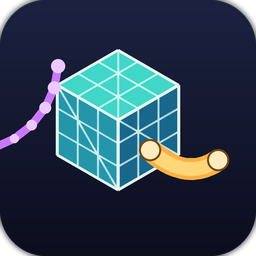

# RemoteRenderer — 메쉬 모델 GPU 렌더링 모드 (Fabric, Minecraft 26.3, 클라이언트 전용)

[English](README.md) | **한국어**



- **GPU 인스턴싱:** BetterModel 본·메쉬, objmc 모델을 모양별로 한 번만 구워 두고, 디스플레이 수와 상관없이 그리기 한 번으로 그립니다.
- **리그:** 리소스팩 파일 하나로 다음을 더합니다(`tools/rig/README.md`).
  - 관절 스키닝(조각 대신 부드럽게 휘는 관절)
  - 원본 텍스처(BetterModel 메쉬의 단색 근사 대신)
  - 머리카락·치마·망토 물리
  - 클라이언트 애니메이션 클립
- **서버 셰이더 호환:** 서버 리소스팩이 아이템 셰이더를 바꿔도(재질, HUD 등) 그 셰이더를 그대로 인스턴싱으로 실행합니다.
- **화면 밖 생략**, 설정 메뉴(Mod Menu / `/remoterenderer menu`), 한국어·영어.
- **빠른 엔티티 처리**(`fastEntities`, 기본 켜짐):
  - RemoteRenderer가 그리는 아이템 디스플레이는 바닐라의 엔티티별 처리(이름표, 스코어보드, 조명 조회, 자세 스택 복사)를 건너뜁니다.
  - 모델이 화면 밖인 디스플레이는 렌더 상태를 추출하기 전에 뺍니다.
  - 이름이 있거나 발광하거나 그림자가 있는 디스플레이는 계속 바닐라 경로로 갑니다.
- **뼈 패킷 묶어 받기**(`bulkData`, 기본 켜짐, Fabric API 필요):
  - ModelEngine(R4.1.0 이상)과 BetterModel(3.3.0 이상)에 이미 있는 클라이언트 모드용 채널 `modelengine:bulk_data`를 등록합니다.
  - 그러면 그 서버들이 뼈마다 보내던 엔티티 데이터 패킷을 모델마다 틱당 패킷 하나로 묶어 보냅니다. 서버 트래픽과 패킷 처리가 줄고, 서버에 설치할 것은 없습니다.
  - GCB 패치판 ModelEngine의 `gcb:bulk_data`는 GCB 모드가 그대로 받습니다(두 채널이 다 있으면 그 ModelEngine이 GCB 채널을 고릅니다). MEG 클라 모드가 깔려 있으면 채널을 그 모드에 맡깁니다.
- **기준:** BetterModel 최신(3.6.0). 서버는 아무것도 바꾸지 않아도 되고, 모드가 없는 플레이어는 지금처럼 바닐라로 봅니다.

BetterModel(본/메쉬 본)과 objmc로 만든 모델은 결국 **아이템 디스플레이 엔티티**로 그려집니다.
바닐라 렌더러는 이걸 매 프레임, 엔티티마다 처음부터 다시 처리합니다.

- 아이템 모델을 매 프레임 다시 해석합니다. BetterModel 메쉬 본은 삼각형 하나당 서브모델 3개짜리 `composite`라서
  삼각형 2304개짜리 본 하나가 **매 프레임 레이어 객체 6912개**를 새로 만듭니다.
- 레이어마다 `submitItem`을 하고, 쿼드의 정점을 전부 CPU에서 변환해 정점 버퍼에 다시 씁니다.

RemoteRenderer는 이 경로를 바꿉니다.

1. 디스플레이의 아이템이 처음 보일 때 그 모델을 **한 번만** 구워 GPU 정점 버퍼에 올립니다. 모양이 같은 디스플레이는 버퍼 하나를 같이 씁니다.
2. 매 프레임에는 디스플레이마다 **행렬 하나**(바닐라가 쓰는 것과 같은 포즈), 노멀 행렬, 조명값만 인스턴스 버퍼에 씁니다.
   그다음 모델별로 **인스턴싱 드로우 한 번**(`drawIndexed(..., instanceCount)`)으로 그립니다.
3. 디스플레이의 아이템이 그대로면(같은 아이템/컴포넌트) 모델 해석 자체를 건너뜁니다.
4. **objmc** 텍스처는 CPU에서 한 번 디코딩해 데이터 텍스처로 올립니다. 프레임 선택, easing(선형/큐빅/베지어), autoplay, 색상 동작(회전/시간/스케일/색조/피격)은
   objmc 셰이더와 같은 계산을 GPU 정점 셰이더에서 합니다. objmc 원본 셰이더는 1.21.x 파일명(`rendertype_item_entity_translucent_cull`)을 덮습니다.
   26.3 아이템 디스플레이는 `core/item`으로 그려져서 바닐라 26.3에서는 objmc 모델이 **보이지 않습니다**. 이 모드를 깔면 보입니다.

서버, 플러그인, 리소스팩은 아무것도 바꿀 필요가 없습니다. 모드가 없는 플레이어는 지금처럼 바닐라로 보입니다.

## 설치

- 대상: Minecraft **26.3**, Fabric Loader **0.19+**, Java 25
- [Releases](https://github.com/RemoteKar/RemoteRenderer/releases)의 `remoterenderer-<버전>+26.3.jar`를 클라이언트 `mods/`에 넣습니다.
- 확인한 환경: 바닐라 Fabric, 그리고 모드 266개짜리 모드팩(Sodium, Sodium Extra, Iris, Lithium, ModernFix, EntityCulling, MoreCulling, Mod Menu 등). OpenGL·Vulkan 둘 다.
- 필수 의존성은 Fabric Loader뿐입니다. `/remoterenderer` 명령어는 Fabric API가 있을 때만 생깁니다. (Fabric API 없이 띄워 보는 테스트는 아직 안 했습니다.)
  셰이더는 jar 안에서 직접 컴파일해서 리소스팩에 의존하지 않습니다. 서버 리소스팩이 `minecraft:*.glsl`을 덮어써도 영향이 없습니다.
- OpenGL·Vulkan 백엔드 모두 동작합니다(26.3의 RenderPearl API만 사용).

## 명령어 (Fabric API 있을 때)

| 명령 | 동작 |
|---|---|
| `/remoterenderer` | 상태와 통계 (FPS, 프레임 ms, 인스턴스/드로우 수, 구운 모델 수, VRAM 사용량) |
| `/remoterenderer on` / `off` | GPU 경로 켜기/끄기 (끄면 완전히 바닐라). 비교할 때 씀 |
| `/remoterenderer stats` | 통계 한 줄 |
| `/remoterenderer clear` | 구운 모델 전부 비우기 |
| `/remoterenderer minquads <n>` | 솔리드 쿼드가 n개 이상인 모델만 GPU 경로 (기본 0 = 전부) |
| `/remoterenderer menu` | 설정 화면 (Mod Menu가 있으면 모드 목록의 설정 버튼으로도 열림) |
| `/remoterenderer rigs` | 불러온 리그와 상태. `rigs on/off`, `rigs play <클립>`(미리보기) |

설정 파일: `config/remoterenderer.properties` (`enabled`, `objmc`, `cacheResolve`, `minQuads`, `statsLogSeconds`, `evictSeconds`, `ignoreCustomItemShaders`, `hideWhileBakingQuads`, `hideWhileBakingMs`, `bakeThreads`)

## 무엇이 GPU 경로로 가고, 무엇이 바닐라로 남나

| 대상 | 처리 |
|---|---|
| BetterModel 큐브 본, 메쉬 본(단면/양면 삼각형), 일반 아이템 모델의 불투명(cutout) 쿼드 | **GPU 인스턴싱** |
| objmc 모델 (아이템 디스플레이, 월드 표시) | **GPU** (디코딩된 데이터로) |
| 반투명 픽셀이 있는 쿼드 | 같은 디스플레이 안에서도 그 레이어만 바닐라로 넘김. 정렬과 OIT는 바닐라가 처리 |
| 발광(glow) 중인 디스플레이 | 바닐라 (외곽선 패스 때문) |
| 특수 렌더러(상자, 머리, 방패, 배너 …), 인챈트 광택 | 바닐라 |
| **Iris 셰이더팩 사용 중** | 구운 모델과 리그를 바닐라 렌더 타입으로 넘겨 셰이더팩 프로그램·그림자로 그림(`shaderCompat`, 기본 켜짐). 모델 해석은 계속 건너뛰고 리그는 CPU 스키닝. Complementary Reimagined에서 리그·메쉬 혼합 장면 17 → 85 FPS, 아주 무거운 메쉬 본 36개 7 → 16 FPS. "켬, 모델 그림자 없음"(`compatShadows=false`)은 셰이더팩 그림자 패스에서 빼서 그 모드에서 약 1.8배 빠르지만, 모델이 그림자를 드리우지 않음 |
| **리소스팩이 아이템 셰이더를 바꾼 서버** (`core/item.vsh`·`item.fsh`나 그 include) | **그 팩의 셰이더를 그대로 인스턴싱으로 실행**(아래 "서버마다 다른 아이템 셰이더"). 재질·HUD 트릭이 그대로 동작. 변환이 안 되는 셰이더면 비켜섬 |
| 손에 든 아이템, GUI | 손대지 않음 |

틴트(`custom_model_data` 색, BetterModel 피격 색 등)는 그대로 반영됩니다. 색이 바뀐 버전은 별도 모델로 한 번 더 구워집니다.

## 끊김(지연) 줄이기

새 모델이 처음 보이는 순간에 렌더 스레드가 하던 일을 모두 뒤로 뺐습니다.

- **처음 보는 아이템은 백그라운드에서 처리**: 구조가 단순한 모델(`model`/`composite`, 즉 BetterModel 본·메쉬 본·objmc)은
  해석 → 키 만들기 → 굽기를 전부 낮은 우선순위의 전용 스레드 2개(`bakeThreads`)에서 합니다.
- **무거운 모델은 굽는 동안 잠깐 숨김**: 쿼드 512개 이상(`hideWhileBakingQuads`)인 모델은 굽는 동안(최대 0.5초, `hideWhileBakingMs`) 그리지 않습니다.
  그 몇 프레임을 바닐라로 그리면 피하려던 멈춤이 그대로 생기기 때문입니다. 대신 1~3프레임 늦게 나타납니다. 가벼운 모델은 그동안 바닐라로 그립니다.
- **같은 아이템은 한 번만**: 같은 아이템·컴포넌트를 한 번 처리하면, 새 엔티티는 해석 없이 바로 그 결과를 씁니다(BetterModel 몹 여러 마리가 나와도 본 종류당 한 번).
- **조건부 모델 캐시**: 해석 경로를 기록해서, `custom_model_data`·컴포넌트·내구도·개수로만 고르는 `select`/`condition`/`range_dispatch`도 캐시합니다.
  BetterModel 플레이어 팔다리(레그돌, 플레이어 애니메이션)가 여기에 해당합니다.
- **매 프레임 할당 없음**: 제출 객체와 묶음 리스트를 재사용합니다.
- 셰이더는 게임 로딩 중에 미리 컴파일합니다.

측정 (서로 다른 메쉬 본 6종 × 4개 = 서브모델 6912개짜리 24개가 같은 틱에 등장, 3회씩, `tests/latency_test.py`):

| | 등장 후 3초 안의 최악 프레임 | 평소 최악 프레임 |
|---|---:|---:|
| 바닐라 | 146 / 152 / 169 ms | 57~93 ms |
| 고치기 전 RemoteRenderer | 102 / 128 ms (이전 측정 방식) | - |
| 지금 | **14.5 / 18.2 / 19.7 ms** | 4~15 ms |

- 렌더 스레드에서 이 모드가 쓰는 시간은 등장 순간에도 0.0ms로 측정됐습니다. 남은 10~20ms 프레임은 백그라운드에서 굽는 동안 CPU를 나눠 쓰는 영향과, 접속 직후 같은 시스템 잡음입니다.
- TopView 레그돌 장면(강제 모드)은 프레임마다 모델을 다시 해석하던 횟수가 약 20분의 1로 줄었습니다. FPS는 330~594 → 650~726, 최악 프레임은 9.6~24ms → 5~8ms입니다.
- 고친 뒤 정상 상태 벤치(OpenGL, `build/bench-opengl-v3.md`): 메쉬 본 36개 1401fps(바닐라 20), 큐브 본 약 2600개 576fps(289), objmc 100개 1571fps(630).
  처음 측정보다 3~17% 낮은데 바닐라도 같은 시점에 4~10% 낮게 나와서, 기계 부하 차이로 보입니다.
  메쉬 장면 중간에 36ms 프레임이 한 번 있었습니다. FPS가 2초간 같이 떨어졌고 그 사이 이 모드가 새로 한 일은 없었지만, 원인은 확인하지 않았습니다.

## 리그: 관절 스키닝, 진짜 텍스처 (2026-11-18)

본 디스플레이 여러 개로 된 모델을 클라이언트에서 **가중치가 들어간 메쉬 하나**로 바꿔 그립니다.
서버와 모드 없는 사람에게는 아무것도 바뀌지 않습니다. 형식과 도구는 `tools/rig/README.md`에 있습니다.

- **관절 보간(`"geometry": "bones"`)**: 본 모델은 그대로 두고, 관절 주변 정점만 두 본 사이에서 섞습니다.
  Test 서버(NightShift) 사람 10종에 적용했습니다(`tools/rig/rig_nightshift.py`). 무릎을 굽히면 허벅지와 정강이가 교차하던 자리가 이어집니다.
  가중치를 하나도 안 준 리그는 원래 본 디스플레이와 인물 부분이 픽셀 단위로 같았습니다.
- **메쉬 리그(glTF)**: 원본 메쉬, 원래 스킨 가중치와 뼈대, 원본 텍스처, 애니메이션 클립을 리소스팩에 넣습니다(`tools/rig/rig_gltf.py`).
  StreetFighter의 `cirno_idle_lp_static`(BetterModel 정적 메쉬)에 적용했습니다. 원본 `cirno.glb`의 뼈 172개와 4096 텍스처 2장을 쓰고, 원래 idle 루프를 클라이언트에서 재생합니다.
- **BetterModel 메쉬 텍스처가 깨지는 이유**: BetterModel(java-mesh)은 메쉬 삼각형마다 단색 조각 3개(`mesh_triangle` + 상수 tint)로 그립니다.
  텍스처를 읽지 않고 색만 근사하므로, 얼굴이나 치마 끝 무늬처럼 삼각형보다 작은 그림은 뭉개집니다. 리그는 텍스처를 그대로 씁니다.
- **BetterModel 최신(3.6.0) 기준**입니다. 본 배치 규칙을 실측해 맞췄고(`tools/rig/bbmodel_rest.py`), `tools/rig/rig_bbmodel.py`가 .bbmodel 하나로 리그를 만듭니다. 테스트 서버(`run_client.py --bm`)도 3.6.0을 씁니다.
- **아틀라스 부담 없음**: 리그 텍스처는 아틀라스 밖(`textures/rig/`)에 두고, 모델이 보일 때만 읽고, 60초 안 쓰면 GPU에서 내립니다. 기본 최대 2048(설정 `rigTextureMaxSize`).
- 성능: cirno(삼각형 20,744개) 1개 = 그리기 2번(텍스처별), 정점 15,048개를 GPU에서 스키닝합니다. 1153fps(테스트 PC).
  BetterModel 방식은 같은 모델이 쿼드 122,304개였습니다.

## 화면 밖 생략, 설정 메뉴, 물리 (2026-11-18)

- **화면 밖 생략:** 바닐라는 디스플레이 엔티티를 화면 밖이어도 전부 그립니다(`Display.noCulling`). RemoteRenderer는 이걸 직접 생략합니다.
  - 일반 디스플레이: 구운 모델의 경계 구로 판정합니다.
  - 리그: 관절별 경계 구를 현재 자세로 옮겨서 판정합니다.
  - 테스트 장면: 바라볼 때 107개 중 75개 생략, 등을 돌리면 107개 전부 생략.
  - 화면 밖 리그는 텍스처도 쓰지 않은 것으로 쳐서, 60초 뒤 GPU에서 내립니다.
- **설정 메뉴:** Mod Menu의 설정 버튼, 또는 `/remoterenderer menu`로 엽니다. 한국어·영어를 지원하고, 닫을 때 `config/remoterenderer.properties`에 저장합니다. 단모 266개(Mod Menu 21.0.0)에서 오류 없이 켜졌습니다.
- **머리카락·치마 물리:** 리그에 선언된 스프링 관절만 흔들립니다. 선언 방법은 `tools/rig/README.md`의 "물리"를 보세요.
  - cirno: 치마 36개, 머리카락 28개, 리본 18개 관절, 허벅지·정강이 충돌 캡슐.
  - 좌우로 흔들면 치마가 반대쪽으로 끌리고 다리를 뚫지 않습니다.
  - 치마 사슬끼리 연결은 없어서, 크게 흔들 때 앞이 갈라질 수 있습니다.
- **치마 사슬 연결:** 물리를 입자 시스템으로 바꿨습니다. 같은 깊이의 옆 사슬끼리 연결 고리(`links`, 도구의 `--link-ring` / `link_rings`)로 묶여서, 치마가 갈라지지 않고 한 덩어리로 흔들립니다.

- **긴 머리·망토:** 같은 스프링 사슬로 됩니다(`tools/rig/README.md`의 "긴 머리, 망토").
  - 긴 머리: VoP 패츄리 `.glb`(뒷머리 5가닥 연결 + 몸 충돌체).
  - 망토: BetterModel 큐브 모델에 서버 쪽 선언(`mantle_*_spring` 그룹 + `.rr.json`)으로 확인했습니다.
  - BetterModel은 `cape_`로 시작하는 그룹을 플레이어 망토 태그로 써서 일반 본을 만들지 않습니다.

## 서버마다 다른 아이템 셰이더 (2026-11-18)

서버 리소스팩이 아이템 셰이더(`core/item.vsh/fsh`나 그 include)를 바꾸면, 이제 비켜서지 않고 **그 팩의 셰이더를 그대로 인스턴싱으로 실행**합니다(`render/PackShaders.java`).
- **방식:** 팩의 버텍스 셰이더에서 입력 선언(Position, Color, UV0~2, Normal)만 지우고, `main()`을 일반 함수로 바꿉니다. 앞에 작은 `main`을 붙여서, 바닐라가 넘기던 값을 구운 모델과 인스턴스(자세·조명)로, 리그면 스키닝으로 채웁니다.
- **나머지는 그대로:** 프래그먼트 셰이더는 팩 것을 쓰고, 파이프라인 설정은 바닐라 아이템 파이프라인(유니폼, 샘플러, define, 깊이, 블렌딩)을 복사합니다. 서버별로 따로 맞출 필요가 없습니다.
- **검증:**
  - 바닐라 셰이더를 이 방식으로 돌려도 바닐라와 같음(최대 차이 3/255).
  - SuperRobotBattle 재질·노멀맵: 2픽셀만 다름.
  - TopViewDemo(아이템 디스플레이로 그린 HUD·미니맵): 정지 장면에서 커서 근처 52픽셀만 다름.
- **화면 밖 생략:** 팩 셰이더가 있으면 일반 디스플레이는 생략하지 않습니다. HUD처럼 셰이더가 다른 곳으로 옮겨 그리는 디스플레이가 있기 때문입니다. TopView HUD가 처음에 이것 때문에 사라졌습니다.
- **변환 실패 시:** 팩 셰이더가 이 방식으로 컴파일되지 않으면 예전처럼 비켜서고, 로그와 설정 메뉴에 이유를 보여 줍니다. 설정 `adaptCustomItemShaders`(메뉴: 서버 셰이더 맞춤)로 끌 수 있습니다.

- **SuperRobotBattle:**
  - 팩이 아이템 셰이더를 직접 씁니다(재질·노멀맵·조명 표식). 위의 방식으로 그 셰이더를 그대로 인스턴싱해 바닐라와 같은 화면입니다. 예전 방식으로 RemoteRenderer 셰이더를 강제하면 재질이 깨졌습니다.
  - 이 팩은 블록·아이템 아틀라스를 각각 8192×8192로 만듭니다.

## 검증한 것 (2026-11-17, RTX 5070 Ti)

- **픽셀 비교 (바닐라 vs RemoteRenderer, 같은 시점 스크린샷)**:
  - BetterModel 메쉬 토러스/구/양면 깃발 + 실제 BetterModel 큐브 본(CobbleMon 서버 팩의 눈설왕 전체 본): 92만 픽셀 중 최대 차이 7/255 (노멀 양자화 수준).
  - item_display 컨텍스트 7종, 틴트, 반투명 섞인 모델, 발광, 바닐라 아이템 12종(블록 아이템, 잔디/나뭇잎 틴트, 유리, 상자, 인챈트 검, 물약, 염색 말갑옷, 머리, 방패, 계단, 유리판): 모델 영역은 동일.
    차이는 구름과 인챈트 광택 애니메이션(시간에 따라 움직임)뿐.
- **실제 BetterModel 3.5.1 플러그인** (DivineMC 26.3, 사용자 서버와 같은 jar): 메쉬 본이 든 `.bbmodel`를 BetterModel이 직접 팩으로 굽고 `/bm test`로 애니메이션 재생.
  큐브 본 + 메쉬 링 + 양면 메쉬 깃발이 바닐라와 같은 모양으로 회전하고 위아래로 움직임.
- **사용자 환경 구성**: Danmo263 인스턴스의 Sodium, Sodium Extra, Iris(셰이더팩 없음), EntityCulling, MoreCulling + Vulkan 백엔드: 충돌 없음, 결과 동일.
- **Iris 셰이더팩 켬**: 모드가 자동으로 꺼지고(`Iris shader pack on: RemoteRenderer steps aside`) 크래시 없음.
- **BetterModel 피격 깜빡임** (CobbleMon 포켓몬 눈설왕·리자몽 + 메쉬 모델, 실제 BetterModel 플러그인):
  - 깜빡임 색(`0xFF8080`)을 유지시킨 화면이 바닐라와 같았습니다(영역 평균색 R155 G75 B72 동일). 끝나면 원래 색으로 돌아옵니다.
  - 실제 피격 때 본마다 빨간 버전이 한 번 구워지고(본 171개, 합계 약 1ms), 두 번째 피격부터는 재사용합니다.
  - 메쉬 본은 바닐라에서도 안 빨개집니다(BetterModel이 메쉬 삼각형 색을 고정).
- **레그돌** (TopViewDemo 사본, Jolt 물리 + BetterModel 플레이어 팔다리, 시체 7종):
  - 기본 설정에서는 TopView 팩의 `item.vsh`를 감지해 비켜섰고, 화면이 모드 없는 것과 같았습니다(HUD·미니맵 포함).
  - 강제로 GPU 경로를 쓰게 하면 정지 시체가 바닐라와 같고(시체 영역 차이 69픽셀), 쓰러지고 잘리는 장면과 플레이어 모델 애니메이션도 같은 방식으로 그려집니다.
  - 다만 TopView HUD는 깨집니다. 그래서 기본값이 "비켜섬"입니다.
- 몹이 처음 나타날 때 셰이더를 컴파일하던 끊김(122ms)을 없앴습니다. 이제 게임 로딩 중에 미리 컴파일하고, 같은 장면의 최대 프레임은 4ms입니다.
- objmc: 애니메이션 8프레임 모델이 같은 시점 스크린샷 3장에서 프레임마다 달라지고, 정지 모델은 0픽셀 차이.
  색상 회전(colorbehavior pitch/yaw/roll)과 autorotate 모두 동작.

## 벤치마크 (같은 장면, 바닐라 렌더러 vs RemoteRenderer, 1280x720, vsync 끔)

OpenGL, Fabric API만 (`build/bench-opengl-fabricapi.md`):

| 장면 | 바닐라 | RemoteRenderer | 배율 |
|---|---:|---:|---:|
| BetterModel 메쉬 본 36개 (각 삼각형 2304개 = 서브모델 6912개), 회전 | 22 FPS (45.3 ms) | 1697 FPS (0.59 ms) | **x77** |
| BetterModel 큐브 본 모델 25세트 (디스플레이 약 2600개), 회전 | 299 FPS (3.35 ms) | 760 FPS (1.32 ms) | x2.5 |
| objmc 애니메이션 모델 100개, 회전 | 643 FPS* | 1626 FPS | x2.5 |

\* 바닐라 26.3은 objmc를 아예 못 그리므로(보이지 않음) 바닐라 숫자는 참고용입니다.

같은 큐브 본 디스플레이 약 2600개를 등지고 있을 때: 0.2.1은 820 FPS, 빠른 엔티티 처리(0.3.0)는 1820 FPS입니다. 추출 전에 빠지기 때문입니다.

`bulkData`의 서버 트래픽 (클라이언트 하나가 받은 양 = 서버가 그 플레이어에게 보낸 양, `tests/bulk_test.py`):

| 장면 | 일반 패킷 | `bulkData` |
|---|---:|---:|
| BetterModel 리자몽 8마리(각 뼈 92개) 달리기, BetterModel 3.6.0 | 936 KB/s, 초당 31,072개 | 330 KB/s, 초당 369개 |
| 같은 장면 + 계속 회전 | 1,125 KB/s, 초당 약 46,000개 | 400 KB/s, 초당 약 12,000개 |
| ModelEngine 플레이어 모델 8개 회전, GCB 패치판 R4.1.1 | 29.3 KB/s, 초당 1,230개 | 16.5 KB/s, 초당 307개 |

BetterModel은 모델 전체 회전을 엔티티 회전 패킷으로 보내서 그 부분은 남습니다.
뼈 움직임은 두 경로가 같습니다. 디스플레이마다 프레임당 회전량이 같고, 10 FPS에서도 왔다 갔다 하는 흔들림이 늘지 않습니다.
90° 넘게 튀는 프레임은 오히려 일반 패킷 쪽에서만 나왔습니다(부하가 걸렸을 때).
시선을 따라 머리가 도는 ModelEngine 모델을 회전시킨 스크린샷도 모델 가장자리 16~47픽셀만 다릅니다.

Vulkan + Danmo263 렌더 모드(Sodium, Sodium Extra, Iris 셰이더팩 없음, EntityCulling, MoreCulling) — 사용자 클라이언트와 같은 구성 (`build/bench-vulkan-danmo.md`):

| 장면 | 바닐라 | RemoteRenderer | 배율 |
|---|---:|---:|---:|
| BetterModel 메쉬 본 36개, 회전 | 21 FPS (48.6 ms) | 3155 FPS (0.32 ms) | **x153** |
| BetterModel 큐브 본 디스플레이 약 2600개, 회전 | 308 FPS (3.25 ms) | 658 FPS (1.52 ms) | x2.1 |
| objmc 애니메이션 모델 100개, 회전 | 784 FPS* | 2923 FPS | x3.7 |

최악 프레임은 메쉬/큐브 본 장면에서 바닐라 82.0/10.7 ms, RemoteRenderer 6.3/5.5 ms였습니다. objmc 장면만 RemoteRenderer 쪽 최악 프레임이 8.8 ms로 바닐라(7.6 ms)보다 컸고, 원인은 아직 확인하지 않았습니다.
모델을 처음 굽는 비용은 삼각형 2304개짜리 메쉬 본 기준 약 20 ms이고, 모델 종류당 한 번만 듭니다(그 프레임에 끊김으로 보일 수 있음).

메쉬 본은 "모델이 무거울수록" 이득이 커집니다. 바닐라는 삼각형 수에 비례해 CPU 일이 늘지만, 이 모드는 디스플레이당 행렬 하나로 끝납니다.
큐브 본은 원래 쿼드가 적어서 이득이 작습니다. 남는 비용은 디스플레이 엔티티 자체를 처리하는 비용(엔티티 틱, 보간, 거리 판정)입니다.
0.2.1과 0.3.0에서 이 비용을 JFR 프로파일로 찾아 줄였습니다(`tests/jfr_top.py`, `tests/bench_jars.py`).

## 한계 / 아직 안 한 것

- **엔티티 자체는 그대로 있습니다.** 이 모드는 클라이언트에서 *그리는* 비용을 없애고, `bulkData`로 ModelEngine/BetterModel 서버의 변환 패킷을 줄입니다.
  서버가 본마다 디스플레이 엔티티를 만들고 애니메이션을 계산하는 비용은 그대로입니다.
  그것까지 없애려면 서버 플러그인(BetterModel 연동)과 이 모드 사이에 전용 프로토콜이 필요합니다.
  서버가 "모델 X, 위치, 애니메이션 상태"만 보내고 본 계산과 그리기는 클라이언트가 하는 방식입니다. 모드가 없는 플레이어용 폴백도 같이 설계해야 합니다.
- objmc: 다중 텍스처와 텍스처 간 페이드(`interpolation`), 손/GUI 표시는 처리하지 않습니다. objmc 아이템은 아이템 디스플레이일 때만 해당됩니다.
- 반투명 쿼드는 바닐라로 넘깁니다. 반투명이 많은 모델은 이득이 줄어듭니다.
- 아이템 셰이더를 바꾸는 서버는 그 셰이더를 감싸서 실행합니다. 바닐라 아이템 입력(위치·색·UV·조명·법선)을 쓰지 않는 특이한 셰이더라면 맞지 않을 수 있습니다(확인한 3개 팩은 맞음).
- 테스트한 GPU는 NVIDIA(OpenGL/Vulkan) 하나입니다. AMD/Intel, 그리고 여러 명이 접속한 실제 서버에서는 아직 안 돌려 봤습니다.

## 구조

```
mod/src/kr/gcb/remoterenderer/
  RemoteRenderer.java            추출(extract)/제출(submit) 훅의 본체, Iris 셰이더팩 감지
  mesh/MeshCache, MeshKey     "모양이 같은 아이템" 키 → 구운 모델 공유, 안 쓰는 모델은 30초 뒤 해제
  mesh/MeshBaker              레이어 변환·틴트·발광을 반영해 정점 데이터 생성 (putBakedQuad와 같은 값)
  mesh/EntityCache            엔티티별 "지난번 아이템" (같으면 모델 해석 생략)
  objmc/ObjmcDecoder, ObjmcColor   objmc 포맷 디코딩, 색상 동작 계산
  render/MeshFeatureRenderer  26.3 피처 렌더러: prepare 단계에 인스턴스 업로드, execute 단계에 인스턴싱 드로우
  render/MeshPipelines        파이프라인 2개 (일반 메쉬 / objmc), jar 안의 셰이더를 직접 컴파일
  mixin/                      ItemDisplayRenderer, FeatureRenderDispatcher, 렌더 상태 등
mod/resources/assets/remoterenderer/shaders/core/   mesh.vsh/fsh, objmc.vsh/fsh
tools/testpack/   테스트 리소스팩 생성 (java-mesh로 BetterModel과 같은 메쉬 아이템, objmc 인코더, .bbmodel 생성)
tests/run_client.py   바닐라 26.3 서버(또는 --bm: DivineMC+BetterModel) + Fabric 클라이언트로 실제 화면 테스트
tests/bench.py        바닐라 vs RemoteRenderer A/B 벤치마크
tests/bulk_test.py    modelengine:bulk_data vs 일반 패킷 (--bm BetterModel / --me ModelEngine, tests/meprobe-plugin)
```

## 빌드 / 테스트

`mod/build.py`는 Gradle 없이 javac로 빌드합니다. 두 가지가 필요합니다.
- 26.3 클라이언트 jar: 난독화가 없는 버전입니다. 경로는 `mod/build.py`의 `CLIENT_JAR`, 라이브러리는 `CLIENT_LIBS`입니다.
- `mod/lib/`의 jar (저장소에는 넣지 않았습니다. Maven Central / Fabric Maven에서 받으세요):
  - `fabric-loader-0.19.5.jar`, `sponge-mixin-0.17.4+mixin.0.8.7.jar`, `mixinextras-fabric-0.5.5.jar`
  - `fabric-api-base-2.0.6+fcdff87f5d.jar`, `fabric-command-api-v2-3.1.2+fcdff87f5d.jar`, `fabric-networking-api-v1-6.3.10+5c1fee4d5d.jar` (Fabric API 0.163.0+26.3에 들어 있는 것)
  - `modmenu-21.0.0.jar` (컴파일에만 쓰임)

```
python mod/build.py                          # build/remoterenderer-<버전>.jar
python tools/testpack/make_pack.py           # build/dm-testpack.zip
python tools/testpack/make_bbmodel.py        # build/bm/meshtest.bbmodel  (--bm 테스트용)
python tests/run_client.py [--off] [--danmo] [--vulkan] [--bm] [--iris-pack] 단계...
python tests/bench.py [--danmo] [--vulkan] [초]
python tests/bulk_test.py bm|me [조건 ...]   # bulkData vs 일반 패킷 (build/DmProbe.jar / build/MeProbe.jar 필요)
```

테스트 클라이언트는 별도 게임 폴더(`build/client-game`)와 포트(25671/25672/25674)를 써서 다른 서버와 클라이언트를 건드리지 않습니다.
`tests/`의 테스트 도구는 개발자 PC의 폴더 배치(26.3 서버/클라이언트, BetterModel jar 위치)를 가정합니다.

objmc 포맷: https://github.com/Godlander/objmc (MIT, `tools/third_party/objmc/LICENSE`). 이 모드의 디코더와 테스트용 인코더는 그 포맷을 따라 새로 작성했습니다.
